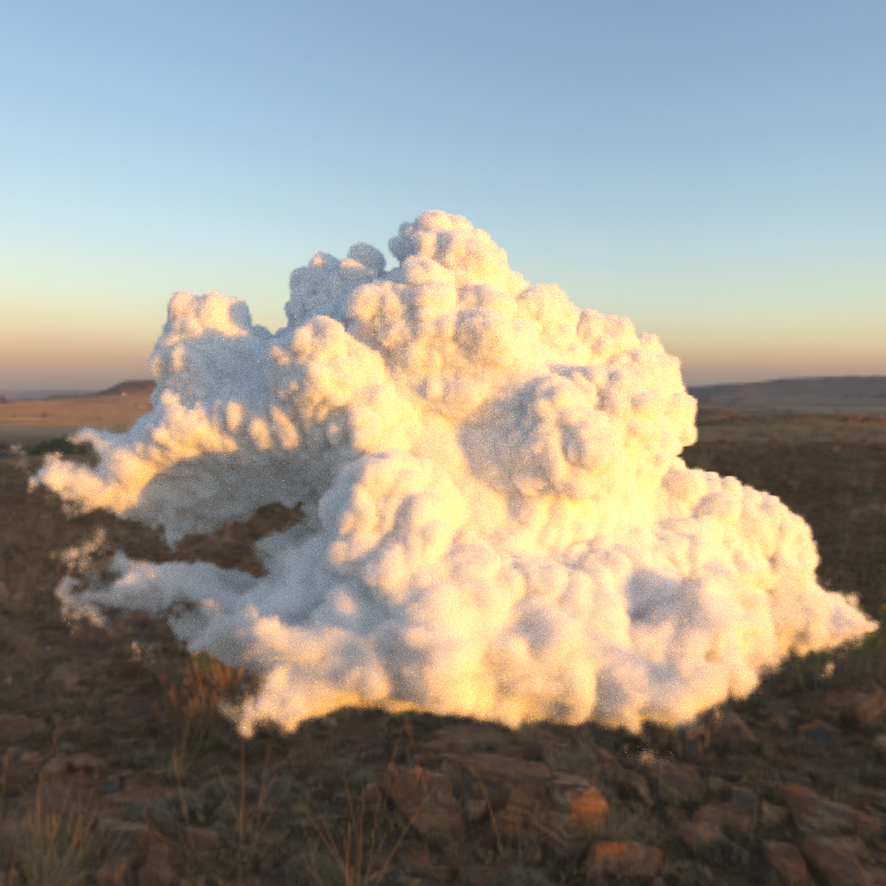

# cloud_renderer

Standalone CLI that renders a heterogeneous participating medium (a density
volume loaded from a `.npy` file) under a directional light and/or an HDR
environment.

Uses rdv's next-event-estimation volume renderers - `PBVR_NEE` for the
directional light, `PBVR_ENV` (importance-sampled via `XREnvironmentSampler`)
for the environment - rather than plain unidirectional path tracing
(`PBVRT`): NEE explicitly samples the light/environment at every scattering
event instead of relying on a random walk happening to hit them, converging
to a clean image in far fewer samples.

## Installation

```
pip install cloud-renderer[png]
```

This pulls in `rendervous` (which pulls in `vulky`), `numpy`, and `torch`.
The `[png]` extra adds `Pillow`, needed only for `.png` output - omit it if
you only save `.npy`.

Installs a `cloud-renderer` command on PATH.

## Colab demo

[](https://colab.research.google.com/github/rendervous/cloud_renderer/blob/main/colab/cloud_renderer_demo.ipynb)

`colab/cloud_renderer_demo.ipynb` installs this package straight from GitHub,
downloads the shared 500-cloud dataset from
[Hugging Face](https://huggingface.co/datasets/rendervous-project/compact_clouds)
(`clouds_500.h5`, ~13.7 GB, cached locally),
extracts one cloud into a raw `.npy` volume, renders it, and displays the
result with matplotlib.

## Example

`examples/disney_cloud.npy` (the classic Disney/WDAS cloud VDB, 256³) lit by
`examples/syferfontein_sky.npy` (Poly Haven's Syferfontein HDRI,
downsampled to 1024x2048), rendered at 1024 samples/pixel, 1024x1024,
in ~4min on an RTX 2080 Ti (`--batch_samples 4` here since the default of
16 trips Windows' TDR watchdog at this resolution/bounce count - see the
parameter table below):

```
cloud-renderer \
    --volume_path examples/disney_cloud.npy \
    --environment_path examples/syferfontein_sky.npy \
    --density_scale 500 \
    --scattering_albedo 0.999 0.999 0.999 \
    --phase_g 0.0 \
    --light_intensity 0 0 0 \
    --bounces 32 \
    --samples 1024 \
    --batch_samples 4 \
    --camera_origin 2.0 0.12 0 \
    --camera_target 0 0 0 \
    --width 1024 --height 1024 \
    --output_path examples/disney_cloud_syferfontein_1024spp.png
```



(`--light_intensity 0 0 0` disables the directional light here - the scene
is lit entirely by the HDR environment. `density_scale=500` and
`scattering_albedo=(0.999,0.999,0.999)` match this dataset's own established
convention elsewhere in `rendervous.project`.)

## File formats

- `--volume_path` (required): `.npy`, shape `(D, H, W, 1)`, float - raw
  extinction/density grid. Scaled at render time by `--density_scale`.
- `--environment_path` (optional): `.npy`, shape `(H, W, 3)`, float -
  equirectangular HDR radiance map, standard top-row-first image convention
  (flipped automatically to match rdv's own v-coordinate convention
  internally). Mutually exclusive with `--environment_color`. If neither is
  given, there's no visible background or environment illumination - only
  the directional light contributes.
- `--environment_color` (optional): constant ambient color instead of an
  HDR image - mutually exclusive with `--environment_path`. Uses a uniform
  sphere direction sampler (`UniformEnvironmentSampler`, see
  `uniform_environment_sampler.h`) instead of `XREnvironmentSampler`'s
  image-based importance sampling, since there's no spatial structure in a
  constant color to importance-sample - every direction is equally likely
  (pdf = 1/4pi), so the sampled color comes out scaled by 4pi (weight = 1/pdf).
- `--output_path` (required): `.npy` saves the raw linear `(H, W, 3)` radiance;
  `.png` applies gamma correction (`clip(x, 0, 1) ** (1/2.2)`) and saves an
  8-bit image. Both are flipped back to normal top-row-first order before
  saving (rdv's own renderer outputs images bottom-row-first).

## Parameters

| Flag | Default | Meaning |
|---|---|---|
| `--density_scale` | `1.0` | multiplier on the raw volume values |
| `--light_direction` | `0 1 0` | directional light direction |
| `--light_intensity` | `0 0 0` | directional light radiance; `0 0 0` disables it |
| `--scattering_albedo` | `1 1 1` | single-scattering albedo (RGB) |
| `--phase_g` | `0.0` | Henyey-Greenstein anisotropy, `[-1, 1]` |
| `--bounces` | `32` | max scattering bounces per path |
| `--samples` | `64` | Monte Carlo samples averaged per pixel |
| `--batch_samples` | `16` | samples per single GPU dispatch (accumulated via `average()`) - all accumulation stays on-device, only the final image is moved to host memory. Lower this if you hit `ErrorDeviceLost` (Windows' TDR watchdog killing a dispatch that ran too long at high resolution/bounce/sample-per-dispatch combinations, not a real crash) |
| `--camera_origin/target/up` | `0 0 3` / `0 0 0` / `0 1 0` | camera pose |
| `--width/height` | `512` | output resolution |
| `--fov` | `45` | vertical field of view, degrees |
